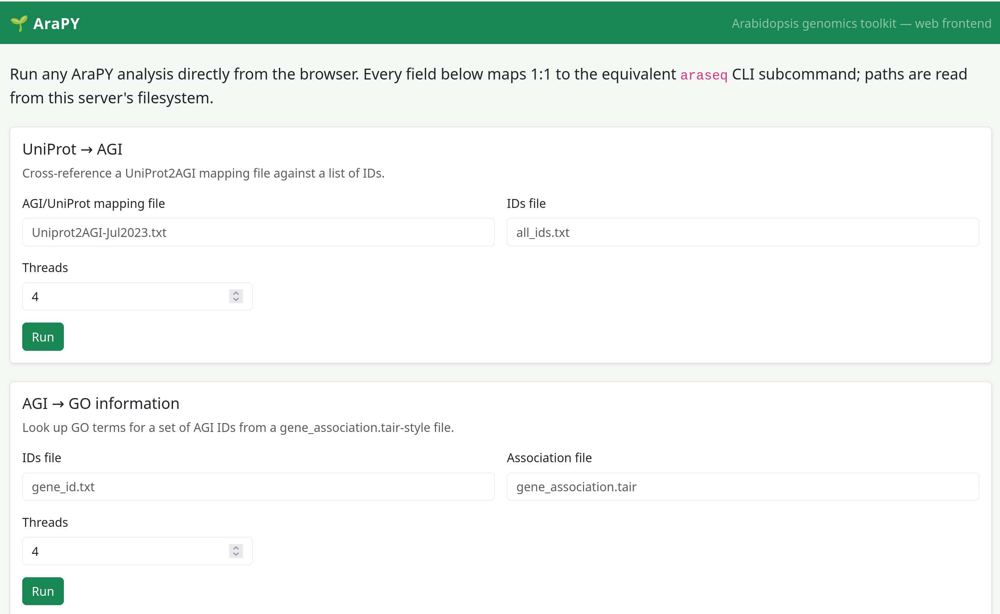
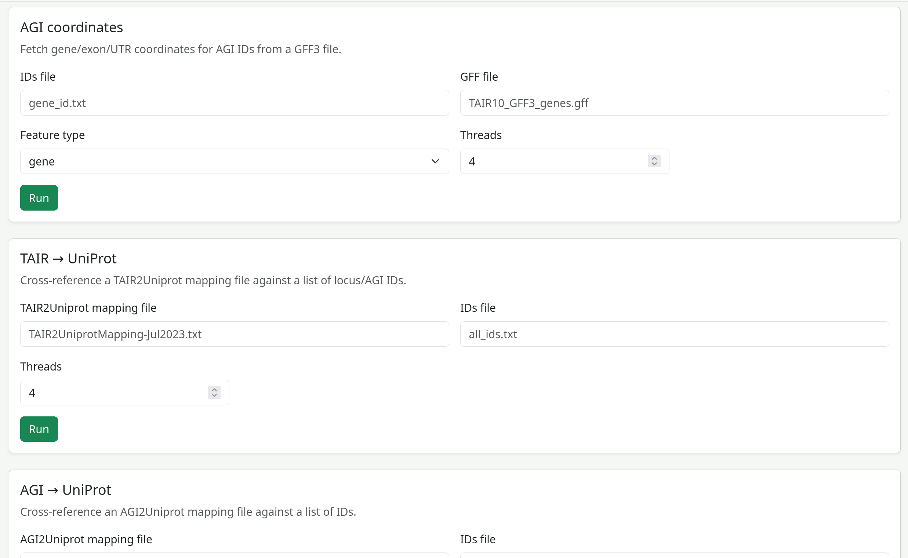
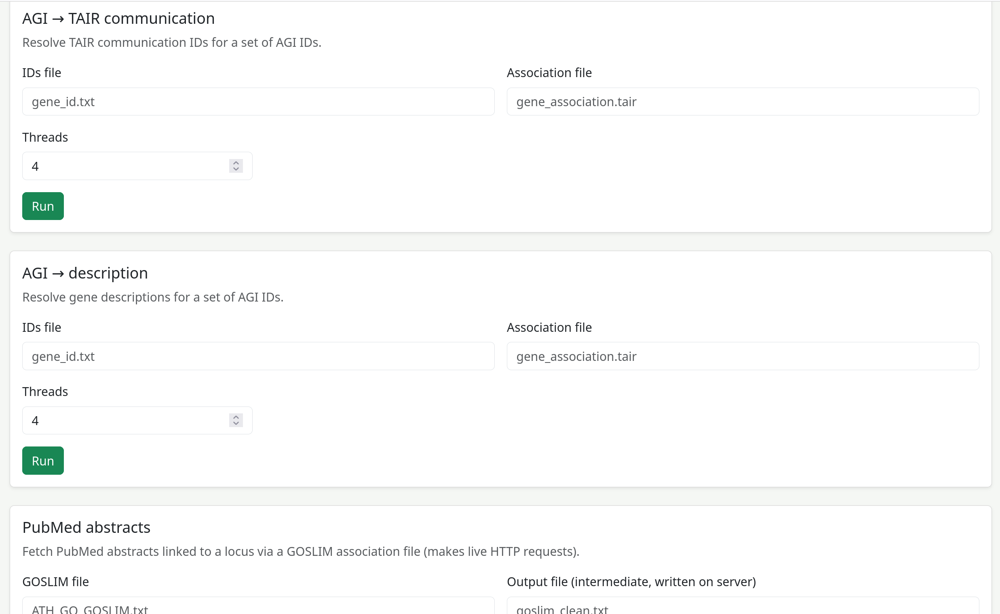
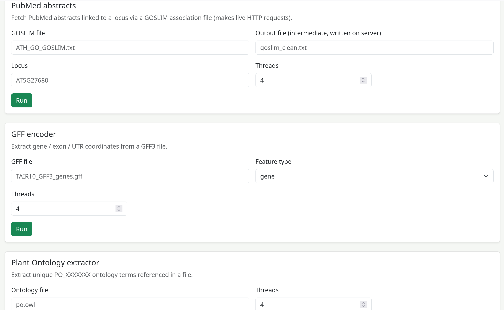
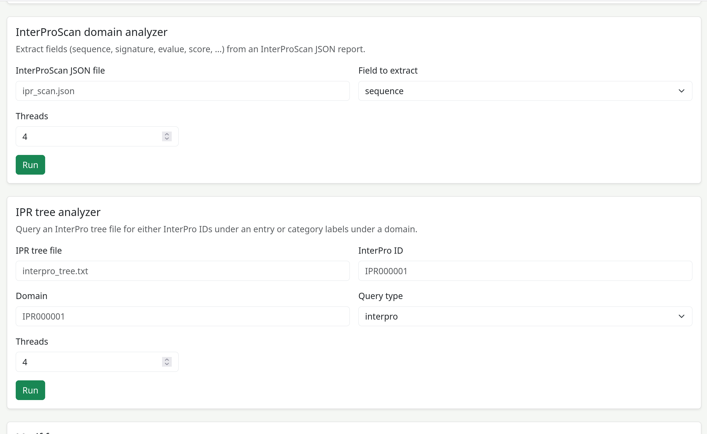

# araseq

- complete analysis profiling for the land plant genomcis and bioinformatics.
- putting the complete TAIR in your hand using RUST. Faster asynchornous and memeory safe.

```
cargo build
cargo run server 3000
```








``` 
     _                     ____   __   __
    / \     _ __    __ _  |  _ \  \ \ / /
   / _ \   | '__|  / _` | | |_) |  \ V / 
  / ___ \  | |    | (_| | |  __/    | |  
 /_/   \_\ |_|     \__,_| |_|       |_|  
                                         

araseq.
       ************************************************
       Author Gaurav Sablok,
       Email: gsablok@proton.me
      ************************************************

Usage: araseq <COMMAND>

Commands:
  uniprotagi       UNIPROTAGI
  agigo            AGI Go information
  agi-coordinate   AGI Coordinate
  tairuniprot      TAIRUNIPROT
  agiuniprot       AGIUNIPROT
  agitair          AGI TAIR cross link
  agi-description  AGI to descrption association
  agipubmded       Pubmed abstract approach
  gff-encoder      encodes the GFF
  plant-onto       Plant OML analysis
  domain-analyzer  Domain analyzer
  ipr-analyzer     IPR analyzer
  frequency-motif  Frequencyestimate
  help             Print this message or the help of the given subcommand(s)

Options:
  -h, --help     Print help
  -V, --version  Print version

```

